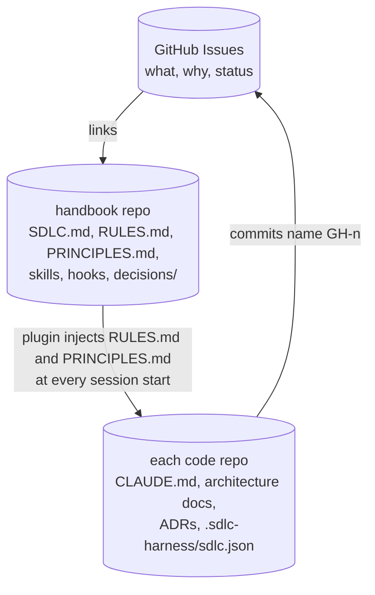
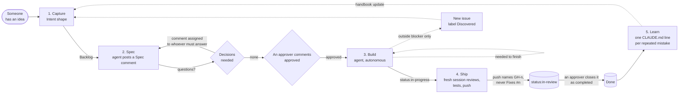
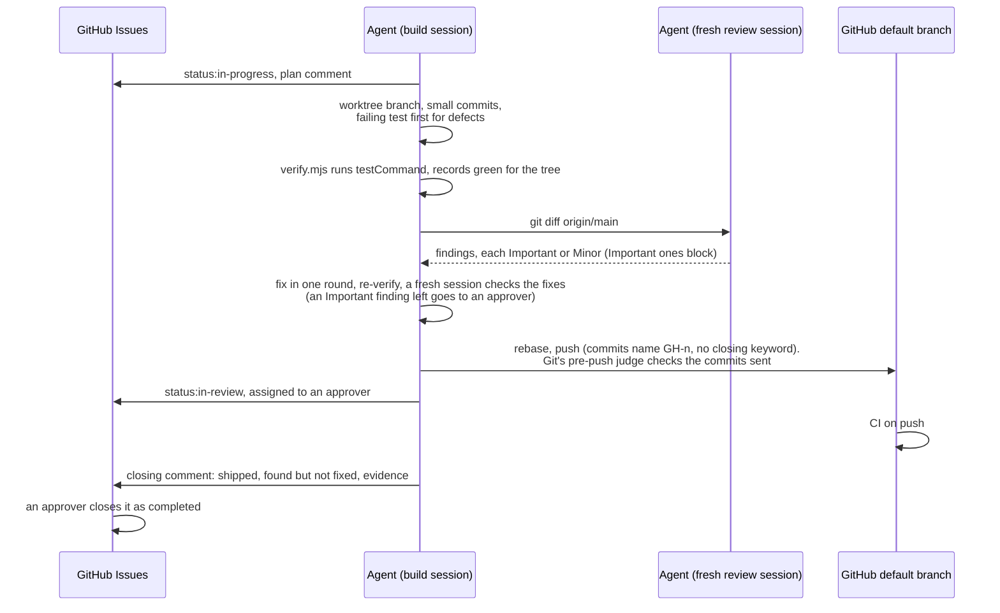
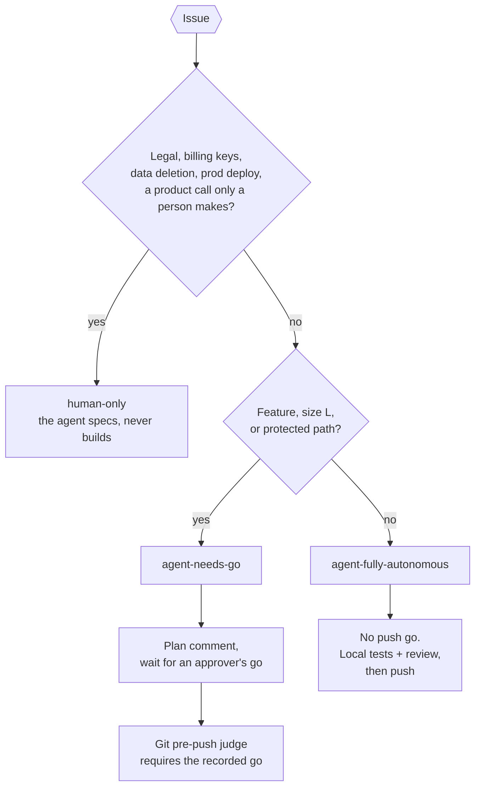

# The SDLC

A small team, one or more repos, GitHub Issues as the source of truth, Claude Code doing most of the execution. Five stages, one GitHub artifact each. The rules the agent follows are in [RULES.md](plugins/sdlc-harness/RULES.md), and the build principles in [PRINCIPLES.md](plugins/sdlc-harness/PRINCIPLES.md); the plugin injects both into every session. This page is the why and the pictures.

## 1. Where the truth lives



| Question | Lives in | Why |
|---|---|---|
| What are we building, why, and where is it? | A GitHub issue in the tracker repo | Status must be in one place, where everyone already works. |
| How do we work? | This repo | The agent executes process as skills and hooks. Skills are code. |
| What principles does all code follow? | This repo, `PRINCIPLES.md` | One set for every repo, so the rules do not drift (decision 0006). |
| How is a system built? | That system's repo, within the principles | Only the code can be the truth about the code. |

**The people.** The config names the **approvers** (GitHub logins, with their numeric ids), the **agent** account the agent writes through (a machine user, never a person's account), and any other **people** who file issues. Only an approver's own account approves, gives a go, or accepts (decision 0003).

## 2. The five stages



### Stage 1: Capture (~5 min)

A GitHub issue in the tracker repo with five headings, plain prose:

```
Problem        what is wrong or missing, for whom
Outcome        what is true when this is done
Constraints    money, legal, timing, IP, compatibility
Not in scope   one line, optional
Open questions anything you are unsure about
```

Label by kind (Feature, Improvement, Defect) and by area (`area:<name>`, one per issue). No status label means Backlog. The agent files issues here too, with `/ticket`. No title says "epic": work too big for one outcome is a parent issue with sub-issues, and only the sub-issues are specced and built.

**Intake checks (decision 0002).** Before the agent specs or builds an issue, `hooks/policy.mjs` checks it: the Intent shape, and no spec in the body unless an approver applied `human-architected`. A refused issue gets one comment saying why, ever, and goes back to its human creator.

### Stage 2: Spec (~10 min)

`/spec GH-n` reads the issue and the repo and posts a `## Spec` comment through the agent's own account, so the description stays the author's intent:

```
Acceptance criteria   3 to 7 checkboxes, each testable
Touches               the repo it lands in, then files or subsystems, protected paths flagged
Size                  S (hours) / M (a day) / L (days)
Autonomy              agent-fully-autonomous, agent-needs-go, or human-only (also applied as a label)
Decisions needed      at most 3 questions, each with a recommended answer
```

An approver approves the Spec with a comment from their own account whose line is just `approved` or `go`. That comment is the only license to build. A Spec edited after the approval drops it; a revision after approval is a new comment.

### Stage 3: Build (agent, autonomous)

`/build GH-n` checks the gates (approved, not `human-only`, intake, the area's in-flight limit), posts a plan comment under 200 words, sets `status:in-progress`, and builds in a local worktree branch. `agent-needs-go` waits for an approver's "go" on the plan. Defects get a failing test first. Anything the issue needs to be finished is fixed on the issue as its own commit; only something outside it that blocks it becomes a `Discovered` issue (decision 0004). For size M and up, or a risky area, a separate read-only agent reviews the plan first.

**The watch.** People update issues at any hour; a session notices only when it looks. So an interactive session in a code repo claims the watch lock (`.git/sdlc-harness/watch.lock`, one watcher per repo) and runs `/loop 15m`. Every tick reads the agent account's unread GitHub notifications through `tracker.mjs inbox`, acts only on the ones its area owns, resumes builds when an approver's go arrives, starts builds when an approval arrives, folds answers into specs, and specs the oldest unlabeled issue. Each repo's watch owns one area (decision 0007), counts its own builds against `inFlightLimit` (default 5), and leaves other areas' notifications unread. The loop dies with the session and adds no authority.

### Stage 4: Ship (gate depends on the label)



Trunk repos push straight to the default branch; GitHub Flow repos open a PR the agent never merges. The closing comment says what shipped, what was found but not fixed, and the evidence.

### Stage 5: Learn

Any mistake the agent makes twice becomes one line in that repo's `CLAUDE.md` or a hook here.

## 3. Autonomy labels



Protected paths are declared per repo in `.sdlc-harness/sdlc.json`: typically migrations, auth, payments, permissions, CI config, deploy config, and dependency manifests.

## 4. GitHub mapping

| Concept | GitHub |
|---|---|
| Backlog | Open issue, no status label |
| Not Started | `status:not-started` (never an approval) |
| In Progress | `status:in-progress` (counts toward the limit) |
| In Review | `status:in-review`, assigned to an approver |
| Done | Closed as completed, by an approver |
| Canceled | Closed as not planned |
| Status on a board instead | `tracker.states: "project"`: a Projects (v2) single-select field |
| Autonomy | `agent-fully-autonomous`, `agent-needs-go`, `human-only` labels |
| Kind of work | `Feature`, `Improvement`, `Defect` labels; `Discovered`, `human-architected` |
| Work area (owner) | One `area:<name>` label |
| Release or date | Milestone |
| Epic | Parent issue with sub-issues |
| Approval, go | An approver's comment with a line that is just `approved` or `go` |
| Issue id in commits | `GH-n` (GitHub's own autolink), never `Fixes #n` |

## 5. Integration: trunk by default, switchable per repo

A worktree branch exists for session isolation only, is never pushed on a trunk repo, and is rebased onto the default branch and pushed there when the slice is done.

| What a PR used to do | Trunk equivalent |
|---|---|
| Reviewer is not the author | Fresh session reviews `git diff origin/main` before push |
| Main stays green | `verify.mjs` records green for the exact tree once git is proven to run the push judge, which refuses a tree sent without it |
| The go gate | Git's pre-push judge refuses commits that change a protected path without an approver's recorded go (decision 0005). It stops mistakes, not a determined bypass. A person removes it with `node <plugin root>/hooks/uninstall-hooks.mjs` |
| Status transitions | `/ship` sets In Review; an approver closes the issue |
| Evidence record | The closing comment |

`github-flow` is for repos with outside contributors. Branch protection with required status checks is the server-side backstop for either mode.

## 6. Session start and the hook-output cap

Claude Code keeps each hook command's output whole only up to 10,000 characters; a longer one becomes a 2,000-character preview. So session start prints in parts, each its own command and under 9,500 characters: the rules in up to four parts, the principles, and the repo's facts with the watch text (decision 0008). A test fails if any part grows past it.

## 7. ADRs

Kept, narrowed. Trigger: the decision constrains more than one future feature and costs more than a day to reverse. Cap 400 words. Proposed on the issue first, written in the same commit as the code. Repo decisions live in that repo; company-wide ones in [decisions/](decisions/).
